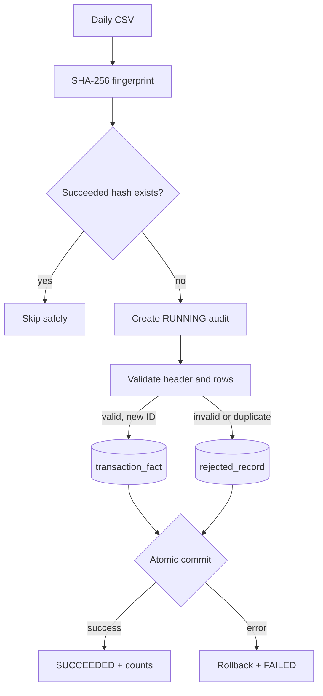

# Processing flow

File hashes prevent accidental replay of renamed files. The transaction ID remains the
business-level uniqueness control across different files. Both are needed: a hash alone
cannot catch the same transaction arriving in a corrected or consolidated extract.

